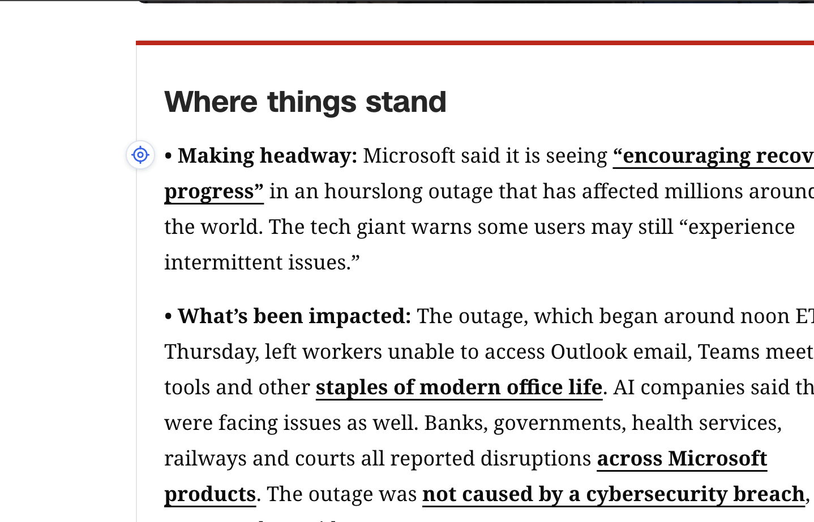
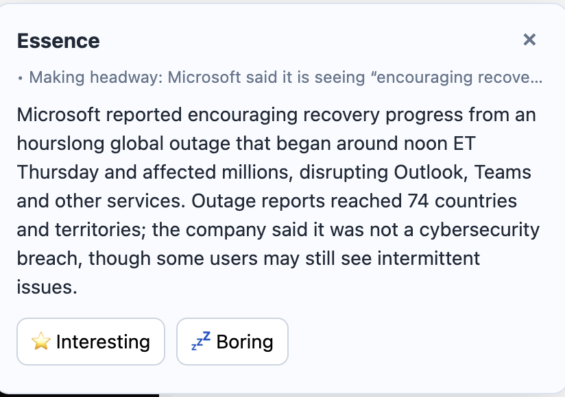

# Essence

A Chrome extension (Manifest V3) that summarizes long articles with AI, on demand.

When it's enabled, Essence places a small target icon next to long articles. Click the icon and the essence of the text appears in a popup in the top-right corner. **The page itself is never modified.** Nothing is inserted into the article, hidden or rearranged.

> Status: early prototype (v0.3.1). Expect rough edges on some sites.

## Screenshots

The Essence icon next to an article:



The summary popup:



## Features

- **On demand only.** Nothing is sent anywhere until you click the icon.
- **Leaves the page alone.** The icons and the popup live in a separate overlay above the page. Close the popup with × or Esc.
- **Bring your own AI provider:** OpenAI, Claude (Anthropic), Grok (xAI) or any OpenAI-compatible API.
- **Configurable output:** the essence (always), plus key points, topics and keywords, a conclusion and a personalized interest score.
- **Learns locally.** Rate summaries as *Interesting* or *Boring*. After 3 ratings Essence starts predicting how interesting new articles are for you. The ratings never leave your browser.
- **Editable prompt.** You can view and edit the exact instructions sent to the AI, with a live preview of the full request.
- **Cost control:**
  - a daily request limit
  - token and estimated-cost tracking
  - a cache, so the same text is never analyzed twice
- **Per-site switch.** Disable Essence on any site from the toolbar popup.

## Installation

1. Download or clone this repository.
2. Open `chrome://extensions` and turn on **Developer mode**.
3. Click **Load unpacked** and select the repository folder.
4. Open the extension's **Settings**:
   - choose a provider
   - enter your API key
   - check the model name
5. Click the Essence toolbar icon and turn on **Show analysis icons**.

After updating the files, click **Reload** on the extension in `chrome://extensions` and reload any open tabs.

## Settings

| Setting | Where | Default |
|---|---|---|
| Show analysis icons | Toolbar popup | Off |
| Minimum text length | Toolbar popup | 1,000 characters (300–20,000) |
| Disable for this site | Toolbar popup | – |
| Panel content (score, key points, topics, conclusion) | Settings | Essence only |
| AI provider, endpoint, model, API key | Settings | OpenAI, `gpt-4o-mini` |
| Daily request limit | Settings | 50 (0 = unlimited) |
| Token prices for cost estimates | Settings | 0 |
| AI prompt and output language | Settings | Built-in prompt, Bulgarian |

### Providers

| Provider | Endpoint | Default model |
|---|---|---|
| OpenAI | `https://api.openai.com/v1/chat/completions` | `gpt-4o-mini` |
| Claude | `https://api.anthropic.com/v1/messages` | `claude-sonnet-4-5-20250929` |
| Grok (xAI) | `https://api.x.ai/v1/chat/completions` | `grok-4.7` |
| Other | any OpenAI-compatible Chat Completions URL | – |

The model names are presets and may go out of date. Check your provider's documentation and edit the **Model** field if needed. API keys are stored separately for each provider.

## Privacy

- **What is sent:** the page title and up to 12,000 characters of the article. They go only to the endpoint you configured, and only when you click the icon.
- **Your API key:** stored **unencrypted** in `chrome.storage.local` of your Chrome profile. It is not synced. Use a key with a spending limit.
- **Ratings, usage statistics and cached summaries** stay in your browser.
- **Permissions:**
  - The extension asks for `<all_urls>` so that it can detect articles on any site and call any provider endpoint you choose.
  - `src/shared.js` is a web-accessible resource, so a website could detect that Essence is installed.

## Development

Requires Node.js 20 or newer. No build step: the extension runs straight from the source folder.

```bash
npm test                      # unit tests for src/shared.js
```

Browser smoke tests load the extension in Chromium with local test pages and a fake AI server:

```bash
npm install --no-save playwright && npx playwright install chromium
npm run test:e2e
```

`tests/e2e/untouched.cjs` checks that the page's HTML is byte-for-byte identical before and after analyzing it.

### Project structure

```
manifest.json        Extension manifest (MV3)
src/background.js    Service worker: AI requests, cache, limits, usage, ratings
src/content.js       Overlay icons and result popup (never modifies the page)
src/detect.js        Article detection and icon placement
src/shared.js        Settings, prompt building, parsing, interest scoring
src/popup.*          Toolbar popup
src/options.*        Settings page
tests/               Unit tests and browser smoke tests
```

## License

[MIT](LICENSE) © 2026 Yavor Yankov
